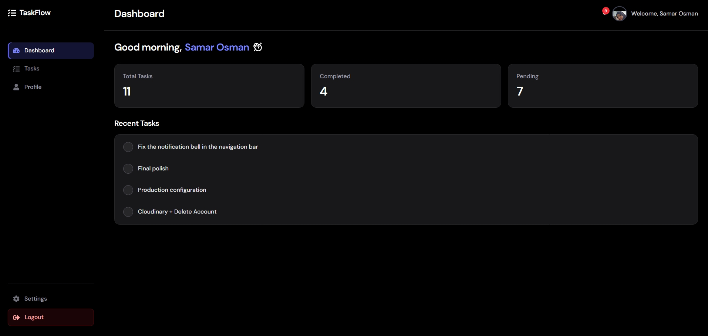
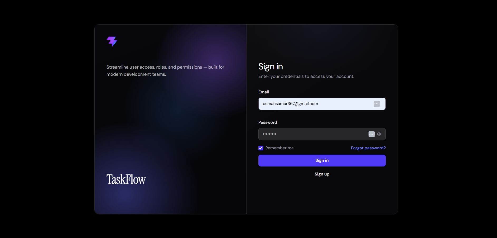
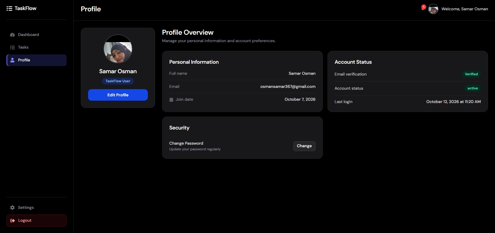
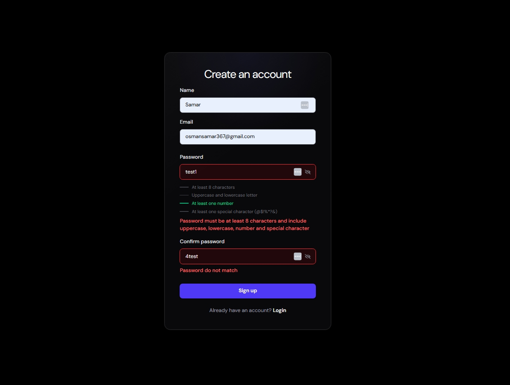
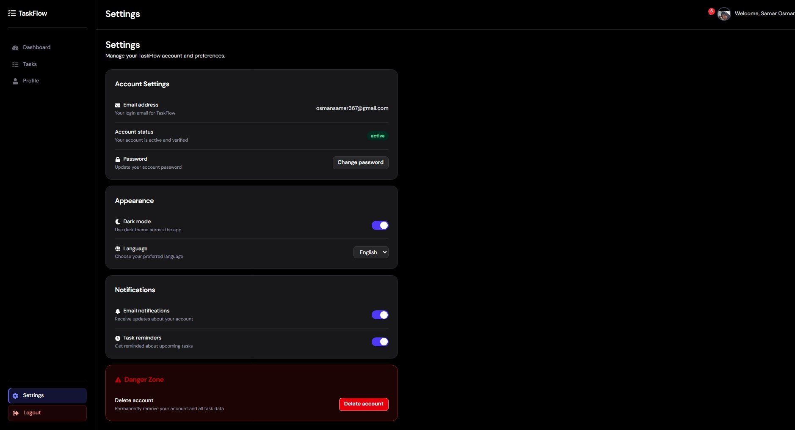
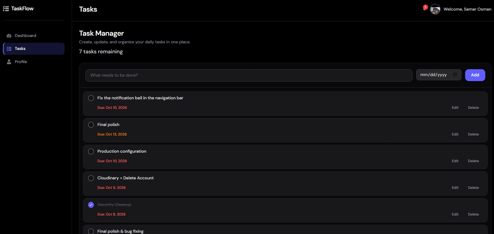

# TaskFlow — Full-Stack Task Management App

TaskFlow is a full-stack web application built with React, Node.js, Express, and SQLite. It helps users manage their accounts and organize everyday tasks in one place.

## Features

### Implemented

- **Authentication:** User registration, login, logout, and session-based authentication.
- **Password Security:** Password hashing with bcrypt and password change functionality.
- **Email Verification:** Verification emails, expiring verification tokens, resend functionality, and protection against login before email verification.
- **User Profiles:** View and edit profile details, including profile image uploads using Cloudinary.
- **Task Management UI:** Create, edit, delete, complete, filter, and clear completed tasks.
- **Persistent User Data:** Store user account data in SQLite.
- **Email Reminders:** Scheduled email reminders for tasks due tomorrow.
- **In-App Notifications:** Notifications for upcoming and overdue tasks, with read/unread status. Reminder behavior is still being tested.

### In Progress

- Backend integration for task persistence.
- Connecting the dashboard to real task data.
- Saving settings such as dark mode, language, and notification preferences.
- Completing the forgot-password and reset-password backend flows.
- Remember Me and account deletion.
- Final testing and deployment.

## Tech Stack

**Frontend**

- React
- React Router
- Vite
- Tailwind CSS
- React Icons

**Backend**

- Node.js
- Express.js
- bcrypt
- express-session
- CORS
- Multer
- Cloudinary
- Resend

**Database**

- SQLite with better-sqlite3

## Project Structure

```text
TaskFlow/
├── public/
├── src/
│   ├── components/
│   ├── context/
│   ├── pages/
│   ├── utils/
│   ├── App.jsx
│   └── main.jsx
├── server/
 ├── config/
│   ├── database/
│   ├── routes/
│   ├── utils/
│   └── server.js
├── package.json
├── vite.config.js
└── README.md
```

_The structure above is illustrative; update it to match the actual repository._

## Getting Started

### Prerequisites

- Node.js 24.x
- npm
- Git

### 1. Clone the repository

```bash
git clone YOUR_PUBLIC_REPOSITORY_URL
cd TaskFlow
```

### 2. Install dependencies

```bash
npm install
```

If the backend has a separate `package.json`, install its dependencies from the backend directory as well.

### 3. Configure environment variables

Create the environment configuration required by the backend. Add the necessary database, email, and Cloudinary settings according to the project's configuration.

Never commit real API keys, passwords, session secrets, or other credentials.

### 4. Start the backend

From the project root, run:

```bash
node server/server.js
```

The API is expected to run at:

```text
http://localhost:3000
```

### 5. Start the frontend

Open a second terminal in the project root:

```bash
npm run dev
```

Open the local URL displayed by Vite, usually:

```text
http://localhost:5173
```

## Screenshots

Screenshots of the actual TaskFlow application interface.

### Dashboard



### Login Page



### Profile Page



### Registration Page



### Settings Page



### Tasks Management



## Testing

Authentication and user-data operations have been tested using Postman and SQLite database tools. Further testing is needed for task reminder counts, notification deduplication, and unfinished backend integrations.

## Future Improvements

- Complete backend persistence for tasks and settings.
- Improve notification reliability and reminder scheduling.
- Finish password recovery and account management flows.
- Deploy the application.

## Author

Developed as a full-stack portfolio project.
